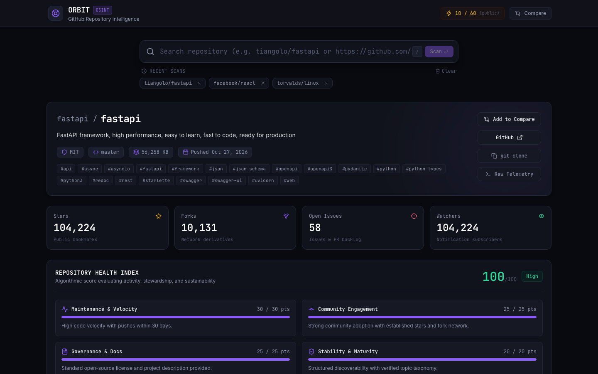
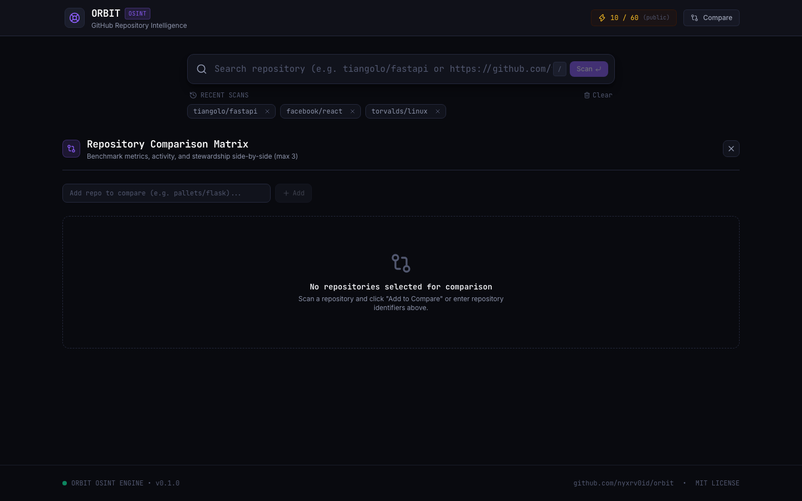
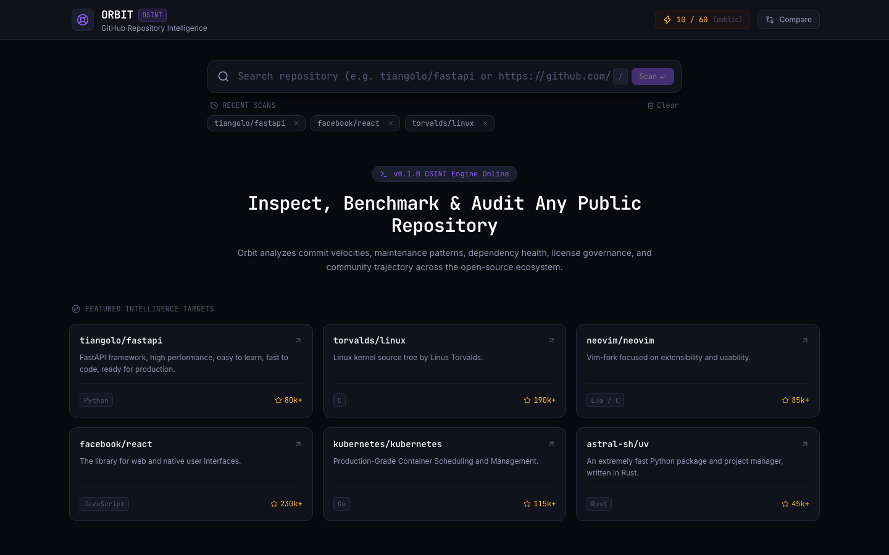
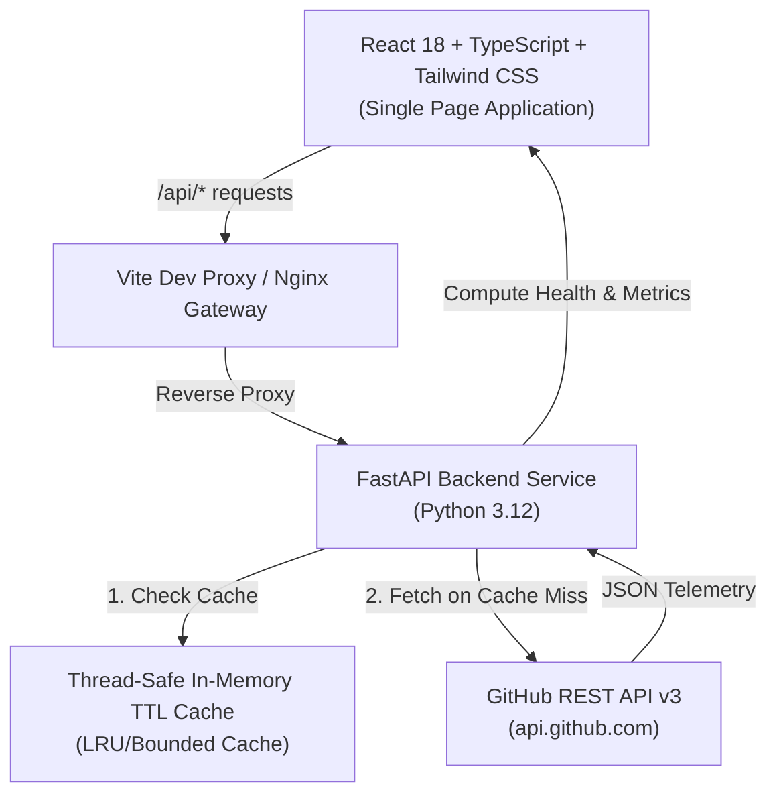

<div align="center">

# ORBIT

**Open-Source Intelligence (OSINT) Dashboard for GitHub Repositories**

[](https://github.com/nyxrv0id/orbit/actions/workflows/ci.yml)
[](LICENSE)
[](https://www.python.org/)
[](https://react.dev/)
[](https://fastapi.tiangolo.com/)

A developer-first intelligence dashboard for discovering, auditing, benchmarking, and tracking public GitHub repositories. Built with a restrained, dark developer aesthetic, real-time rate limit telemetry, and algorithmic repository health indexing.

[Features](#features) • [Preview](#preview) • [Architecture](#architecture) • [Quick Start](#quick-start) • [API Reference](#api-reference) • [Health Index Methodology](#health-index-methodology)

</div>

---

## Preview

<div align="center">

### Intelligence Overview & Repository Inspection


### Side-by-Side Comparison Matrix


### Search Radar & Discovery


</div>

---

## Overview

**Orbit** provides real-time telemetry and algorithmic analysis of public GitHub repositories without requiring authentication (though tokens are supported for high-throughput analysis). Rather than simply presenting raw counts, Orbit computes multi-dimensional health metrics, evaluates maintenance velocity, parses dependency byte breakdowns, streams recent release assets, and allows side-by-side benchmarking of up to three repositories simultaneously.

### Key Capabilities

- **Deep Repository Inspection**: Comprehensive breakdown of stars, forks, open issues/PR backlog, subscribers, primary language, license governance, and topics.
- **Algorithmic Health Score (0–100)**: Evaluates maintenance velocity, community engagement, documentation completeness, and codebase stability with transparent reasonings.
- **Side-by-Side Comparison Matrix**: Benchmark up to 3 repositories across 8 distinct metrics with leader badges and visual differentiators. Supports both shareable query URLs and programmatic POST payloads.
- **Activity & Release Radar**: Streams recent commit logs with author metadata and verified GitHub release asset download packages.
- **Multi-language Byte Distribution**: Visual progress spectrum mapping exact language percentages and byte allocations.
- **Search History & Quick Navigation**: Persists recent investigations locally with instant keyboard shortcuts (`/` to focus search).
- **Graceful Rate-Limit Telemetry**: Live rate-limit pill displaying real-time quota remaining and exact UTC reset timestamps.

---

## Architecture



### Technology Stack

| Layer | Technologies |
| :--- | :--- |
| **Frontend** | React 18, TypeScript, Vite, Tailwind CSS, Lucide Icons |
| **Backend** | FastAPI, Uvicorn, HTTPX (Async), Pydantic v2, Pydantic-Settings |
| **Caching** | Bounded In-Memory TTL Cache (Thread-Safe) |
| **Testing** | Pytest, Pytest-Asyncio, Respx (Backend) • Vitest, Testing Library (Frontend) |
| **Code Quality** | Ruff (Linter & Formatter), Strict TypeScript (`tsc -b`) |
| **Deployment** | Docker, Docker Compose, Nginx Alpine |

---

## Design System

Orbit adheres to a minimal, high-density developer aesthetic:
- **Base Surfaces**: Pitch black (`#090a0f`) and charcoal panels (`#11131c`, `#161824`).
- **Restrained Accents**: Electric violet (`#8b5cf6`, `#7c3aed`) with subdued glow states (`rgba(139, 92, 246, 0.15)`).
- **Typography**: Dual-type system featuring `Inter` for interface readability and `JetBrains Mono` for data and repository identifiers.
- **Data Clarity**: High-contrast badges for health tiers, status indicators, and color-coded language distributions.

---

## Quick Start

### Option 1: Docker Compose (Recommended)

Run the full stack with a single command:

```bash
# Clone the repository
git clone https://github.com/nyxrv0id/orbit.git
cd orbit

# Start backend and frontend containers
docker compose up --build
```

- Frontend: [http://localhost:3000](http://localhost:3000)
- Backend API Docs: [http://localhost:8000/docs](http://localhost:8000/docs)

### Option 2: Local Development

#### Prerequisites
- Python 3.11+
- Node.js 20+ & npm

#### 1. Start Backend

```bash
cd backend

# Create virtual environment
python3 -m venv .venv
source .venv/bin/activate

# Install dependencies in editable mode
pip install -e ".[dev]"

# (Optional) Add your personal GitHub token for 5,000 req/hr quota
cp .env.example .env

# Run server
uvicorn app.main:app --reload --port 8000
```

#### 2. Start Frontend

```bash
cd frontend

# Install dependencies
npm install

# Start Vite dev server
npm run dev
```

Visit [http://localhost:5173](http://localhost:5173).

---

## Health Index Methodology

The Repository Health Index is an automated heuristic scoring model from 0 to 100 designed to measure observable open-source hygiene and velocity indicators from public GitHub API metadata.

> [!NOTE]
> The Health Index is an automated heuristic of repository hygiene and activity. It does not measure internal code quality, architectural correctness, or guarantee individual maintainer responsiveness.

### Evaluation Criteria (Max 100 Points)

| Dimension | Points | Criteria & Measurement |
| :--- | :--- | :--- |
| **Maintenance Velocity** | 30 pts | • 15 pts: Repository active (not archived or disabled).<br>• 15 pts: Code push recency (≤30 days: 15 pts, ≤90 days: 10 pts, ≤180 days: 5 pts). |
| **Community Engagement** | 25 pts | • 10 pts: Community adoption (stars ≥ 50: 5 pts, forks ≥ 10: 5 pts).<br>• 10 pts: GitHub Discussions enabled.<br>• 5 pts: Public issue tracking enabled. |
| **Governance & Docs** | 25 pts | • 15 pts: Standard OSI open-source license detected (SPDX ID).<br>• 10 pts: Clear project description provided. |
| **Codebase Stability** | 20 pts | • 10 pts: Verified discoverability with categorized topic tags.<br>• 5 pts: Custom documentation homepage link provided.<br>• 5 pts: Issue tracking hygiene. |

Scoring Tiers:
- **High (75–100)**: Active velocity, clear license governance, and robust community engagement.
- **Moderate (50–74)**: Stable core with moderate velocity or partial documentation coverage.
- **Low (0–49)**: Inactive, archived, or lacking open-source licensing and governance.

---

## API Reference

The backend exposes interactive OpenAPI documentation at `/docs`.

| Method | Endpoint | Description |
| :--- | :--- | :--- |
| `GET` | `/api/health` | Healthcheck, service uptime, and in-memory cache statistics |
| `GET` | `/api/rate-limit` | Real-time GitHub API rate-limit quota & reset timestamp |
| `GET` | `/api/search?q={query}` | Autocomplete search for public repositories |
| `GET` | `/api/repo/{owner}/{repo}` | Complete enriched metadata and health score breakdown |
| `GET` | `/api/repo/{owner}/{repo}/activity` | Recent commit logs and official GitHub releases |
| `GET` | `/api/compare?repos={o1/r1}&repos={o2/r2}` | Side-by-side comparison matrix via query parameters |
| `POST` | `/api/compare` | Programmatic comparison matrix via JSON request body |

---

## Testing & Quality Assurance

Both frontend and backend are covered by test suites and static analysis.

### Run Backend Tests & Linter
```bash
cd backend
.venv/bin/pytest -v
.venv/bin/ruff check .
.venv/bin/ruff format --check .
```

### Run Frontend Tests & Build Check
```bash
cd frontend
npm test
npm run build
```

---

## License

This project is open-source under the [MIT License](LICENSE).
